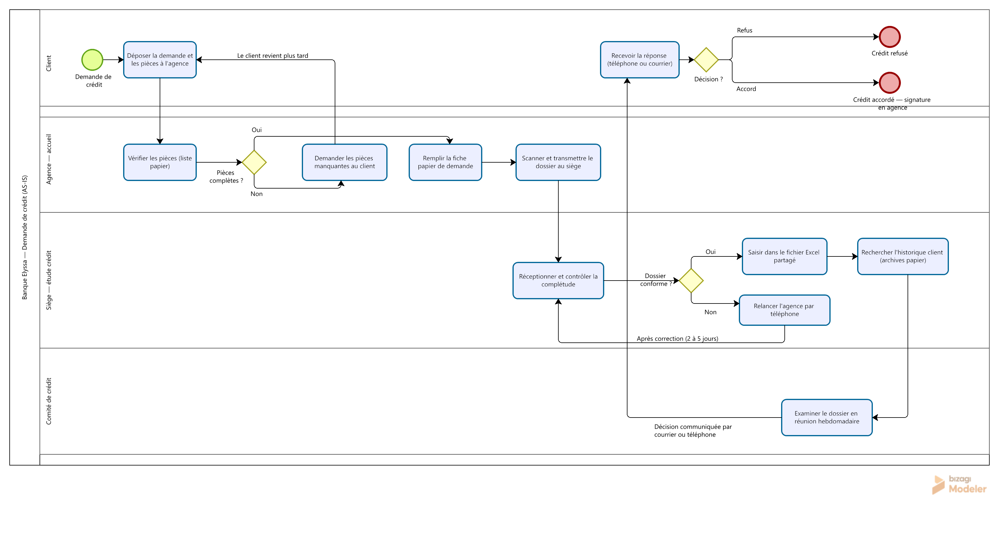

# Cartographie AS-IS — Processus de demande de crédit

**Date :** 26 octobre 2026 · **Auteur :** Eya Kanzari
**Sources :** [synthèse des entretiens](../02-Elicitation/synthese-constats.md) ·
[personas](../02-Elicitation/personas.md) · [note de cadrage](../01-Cadrage/note-de-cadrage.md)

> Cas fictif — Banque Elyssa. Le processus décrit ci-dessous est le processus
> **actuel** (AS-IS), avant digitalisation.

## 1. Vue d'ensemble en quatre couloirs

*Diagramme modélisé sous Bizagi Modeler (standard BPMN 2.0) à partir des constats
des cinq entretiens. Un pool unique, quatre couloirs : Client, Agence — accueil,
Siège — étude crédit, Comité de crédit.*

**Lecture rapide :** le client dépose ses pièces à l'agence ; l'agent vérifie sur une
liste papier non standardisée (boucle 1 si incomplet — le client revient plus tard) ;
le dossier transite par fiche papier puis scan vers le siège ; un second contrôle de
complétude déclenche éventuellement une relance téléphonique (boucle 2) ; puis saisie
dans le fichier Excel et recherche d'historique aux archives papier (boucle 3) ;
enfin passage en comité hebdomadaire et notification du client par courrier ou
téléphone, sans trace ni récépissé.

## 2. Décomposition du délai moyen (12 jours ouvrés)

| Étape | Acteur | Outil | Délai moyen | Remarque |
|---|---|---|---|---|
| Dépôt → envoi au siège | Agence | Papier, scanner | 1 à 2 jours | Attente de regroupement des envois |
| Réception → dossier conforme | Siège | Téléphone, e-mail | 2 à 5 jours | Allongé par les relances (1 dossier sur 3) |
| Étude de solvabilité | Siège | Excel, archives papier | 2 à 3 jours | 20 min de recherche d'historique par dossier |
| Passage en comité | Comité | Réunion hebdomadaire | 0 à 7 jours | Dépend du jour de dépôt |
| Notification → réponse client | Agence | Téléphone, courrier | 1 à 2 jours | Aucune trace, aucun récépissé |
| **Total** | | | **≈ 12 jours** | Cible TO-BE : ≤ 5 jours |

## 3. Les trois boucles qui coûtent cher

**Boucle 1 — Les pièces manquantes** (constats C01, C03, C09)
Le client repart incomplet, revient plus tard (1 à 3 déplacements). À l'arrivée au
siège, 35 % des dossiers sont de nouveau jugés incomplets → **double contrôle, double
rejet**. Coût : temps client + temps agent + allongement du délai.

**Boucle 2 — La relance téléphonique** (constats C09, C12)
Pour chaque dossier incomplet, l'analyste appelle l'agence, attend la correction,
puis reprend l'étude. Délai constaté : **2 à 5 jours**. Aucune trace de la relance
dans un outil partagé.

**Boucle 3 — La recherche d'historique** (constats C11, C10)
L'historique de remboursement d'un client existant se trouve dans les archives
papier : **20 minutes par dossier en moyenne**. Sur 15 à 20 dossiers par semaine,
cela représente 5 à 7 heures hebdomadaires d'analyse perdues.

## 4. Points de rupture du processus

| ID constat | Point de rupture | Conséquence directe |
|---|---|---|
| C02, C07, C15 | Aucune information client entre le dépôt et la décision | 60 % des appels entrants = suivi |
| C05, C10 | Triple saisie (fiche, Excel, compte-rendu) | Erreurs, réconciliation |
| C06 | Règles de complétude non documentées | Rejets évitables |
| C13 | Aucune trace des contrôles effectués | Décisions non justifiables |
| C14, C16 | Indicateurs recalculés à la main | Pilotage à l'aveugle |

## 5. Le modèle BPMN

Le diagramme de la section 1 a été modélisé sous **Bizagi Modeler** en standard
BPMN 2.0 : **1 pool, 4 couloirs, 11 tâches, 3 passerelles exclusives, 2 événements
de fin et 18 flux séquentiels**, dont les trois boucles annotées. La modélisation a
été réalisée en important le processus au format BPMN 2.0 puis en l'ajustant
visuellement (étiquettes de flux, disposition des couloirs) pour la lisibilité.

## 6. Ce que le TO-BE devra résoudre (aperçu semaine 5)

- **Parcours client** : dépôt en ligne + suivi d'avancement + notifications
- **Contrôle de complétude** : règles centralisées, vérification dès le dépôt
- **Donnée unique** : un dossier saisi une seule fois, historique centralisé
- **Traçabilité** : chaque contrôle horodaté et attribué
- **Pilotage** : indicateurs de délai et de qualité calculés automatiquement

---

*Livrables suivants : matrice des douleurs et causes racines, puis BRD (semaine 3).*
