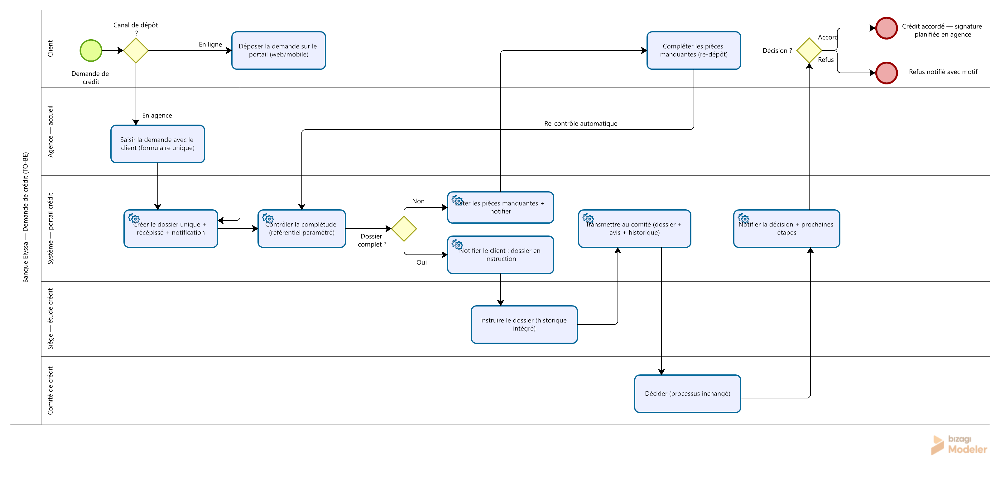

# Processus cible TO-BE — Module de demande de crédit

**Date :** 16 novembre 2026 · **Auteur :** Eya Kanzari
**Source :** [BRD](../03-Analyse/BRD.md) · [AS-IS](../03-Analyse/as-is-processus.md) ·
[user stories](../04-Exigences/user-stories-backlog.md)

> Cas fictif — Banque Elyssa. Processus **cible** (TO-BE) tel que défini par les
> exigences EF-01 à EF-10.

## 1. Ce qui change par rapport à l'AS-IS

| Douleur | AS-IS (avant) | TO-BE (cible) | Mécanisme |
|---|---|---|---|
| D1 — Client aveugle | Dépôt papier, 1 à 3 déplacements, aucun suivi | Dépôt en ligne ou assisté, récépissé immédiat, suivi temps réel + notifications | Portail client + SMS/e-mail (EF-01, EF-07) |
| D2 — Dossiers incomplets | Contrôle humain à l'agence puis au siège, 35 % d'incomplets | Contrôle automatique à la soumission selon référentiel centralisé | Référentiel paramétrable + règle bloquante (EF-03, EF-04) |
| D3 — Saisies multiples | Fiche papier + Excel + compte-rendu (3 saisies) | Une seule saisie, un dossier unique, visible partout | Dossier unique (RG-02) |
| D4 — Historique inaccessible | 20 min de recherche aux archives | Historique client intégré à l'écran d'instruction | Dossier unique + historique (EF-06) |
| D7 — Rien n'est traçable | Aucune preuve des contrôles | Journal inviolable : qui, quoi, quand | Journal horodaté (EF-08, RG-05) |
| D5, D8 — Pilotage | Reporting mensuel manuel | Notifications automatiques + indicateurs continus | Reporting continu (EF-09) |

## 2. Le processus en six temps

1. **Dépôt** — deux canaux convergents : en ligne (client, web/mobile) ou en agence
   (agent, même formulaire). Un seul canal de saisie, donc zéro ressaisie.
2. **Création du dossier unique** — le système crée le dossier, délivre le récépissé
   et notifie le client automatiquement.
3. **Contrôle de complétude automatique** — immédiat, contre le référentiel
   paramétré. Si incomplet : liste exacte des manquants affichée au client, qui
   complète en ligne ou à l'agence, puis re-contrôle automatique. Fin des relances
   téléphoniques.
4. **Instruction** — l'analyste travaille sur le dossier unique avec l'historique
   client intégré. Chaque transition d'état notifie le client et écrit au journal.
5. **Comité** — transmission automatique du dossier complet (pièces, avis,
   historique). La décision reste manuelle et inchangée : c'est une contrainte
   métier, pas une limite technique.
6. **Notification de la décision** — automatique, avec motif en cas de refus et
   prochaines étapes en cas d'accord.

## 3. Choix de modélisation (à savoir défendre en entretien)

- **Le couloir « Système — portail crédit »** matérialise l'outil : les tâches
  automatisées y sont en *service tasks*. Ça rend visibles les 6 automatisations
  (création, contrôle, 3 notifications, transmission) sans rien changer aux rôles humains.
- **L'avis de l'analyste n'est pas une branche du processus** : c'est une donnée
  portée par le dossier vers le comité. Le seul vrai point de décision reste le comité.
- **La boucle d'incomplétude reste** (le client peut manquer des pièces), mais elle
  coûte désormais quelques minutes en ligne au lieu de jours de téléphone.

## 4. Décomposition du délai cible (≤ 5 jours ouvrés)

| Étape | AS-IS | TO-BE | Gain |
|---|---|---|---|
| Dépôt → dossier conforme | 3 à 7 jours | J0 à J+1 (contrôle immédiat) | −3 à −6 jours |
| Étude | 2 à 3 jours | 1 à 2 jours (historique intégré) | −1 jour |
| Comité | 0 à 7 jours | 0 à 3 jours (transmission immédiate) | −4 jours |
| Notification | 1 à 2 jours | Instantanée | −2 jours |
| **Total moyen** | **≈ 12 jours** | **≤ 5 jours** | **−7 jours** |

## 5. Diagramme

*Diagramme modélisé sous Bizagi Modeler (standard BPMN 2.0) : **1 pool, 5 couloirs**
(Client, Agence — accueil, Système — portail crédit, Siège — étude crédit,
Comité de crédit), **11 tâches dont 6 automatisées**, **3 passerelles exclusives**
(canal de dépôt, complétude, décision) et **18 flux séquentiels**, dont la boucle
de re-contrôle automatique en cas de pièces manquantes.*

## 6. Points de contrôle avec les user stories

| Élément BPMN | User stories | Règles de gestion |
|---|---|---|
| Canal de dépôt (passerelle) | US-01, US-04 | RG-02 |
| Contrôle de complétude | US-05, US-06 | RG-01 |
| Notification « en instruction » | US-02, US-07 | RG-04 |
| Instruction analyste | US-08 | RG-03 |
| Transmission comité | US-09 | RG-03 |
| Journal (transverse) | US-10 | RG-05 |

---

*Voir aussi : les [maquettes desktop couleur](wireframes/README.md) (12 écrans, version interactive :
[`wireframes.html`](wireframes.html)) et, en semaine 6, le [business case](../06-Restitution/business-case.md)
et la [matrice de traçabilité complète](../06-Restitution/matrice-tracabilite.md).*
