# Wireframes — Module de demande de crédit

**Banque Elyssa (cas fictif)** · maquettes **low-fidelity en niveaux de gris** · mobile d'abord **390 × 844**
pour le client, desktop **1440 × 900** pour les espaces métier · bilingue **arabe / français** avec mise en
miroir RTL (RG-07).

> La version interactive de toutes les frames est dans
> [`wireframes.html`](../wireframes.html) — chaque écran est traçable vers ses user stories
> ([`user-stories-backlog.md`](../../04-Exigences/user-stories-backlog.md)) et ses règles de gestion
> ([`BRD.md`](../../03-Analyse/BRD.md)).

**Légende des états :** ✔ reçu / conforme · ┄ manquant (bordure pointillée) · ▲ refusé (bordure forte) ·
◷ à venir · brouillon = bandeau gris · consentement = case à cocher (RG-06).

---

## 1. Parcours client — mobile 390 × 844

### Étape 1 · Type de crédit et montant — `US-01 · US-03 · RG-01`

La checklist des pièces se génère depuis le référentiel selon le type choisi ; le brouillon est repris à
l'identique.

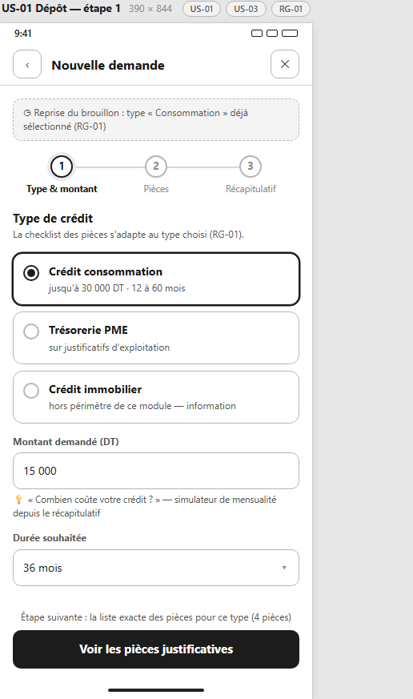

### Étape 2 · Pièces justificatives — `US-01 · US-03 · RG-01`

Chaque pièce a un bouton « photographier » ou « téléverser » et un état explicite : reçue, manquante,
refusée avec la raison (« format illisible »).

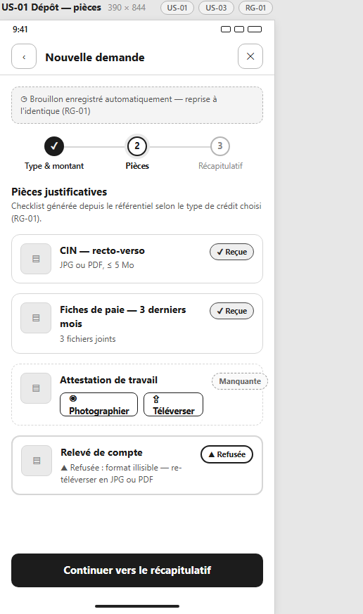

### Étape 3 · Soumission bloquée si dossier incomplet — `US-06 · RG-01`

Le contrôle automatique liste **exactement** les pièces à corriger et affiche la règle appliquée — le client
n'appelle plus l'agence pour comprendre un refus.

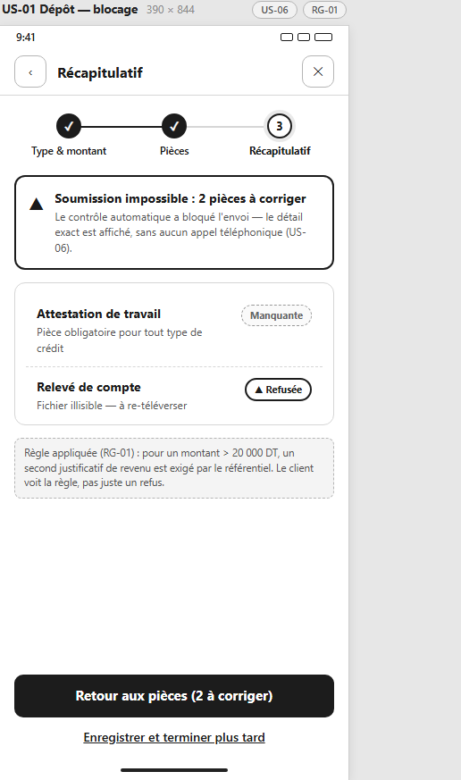

### Étape 3 · Récapitulatif et consentement obligatoire — `US-12 · RG-06 · RG-02`

Le bouton « Soumettre » reste désactivé tant que le consentement au traitement des données n'est pas coché.

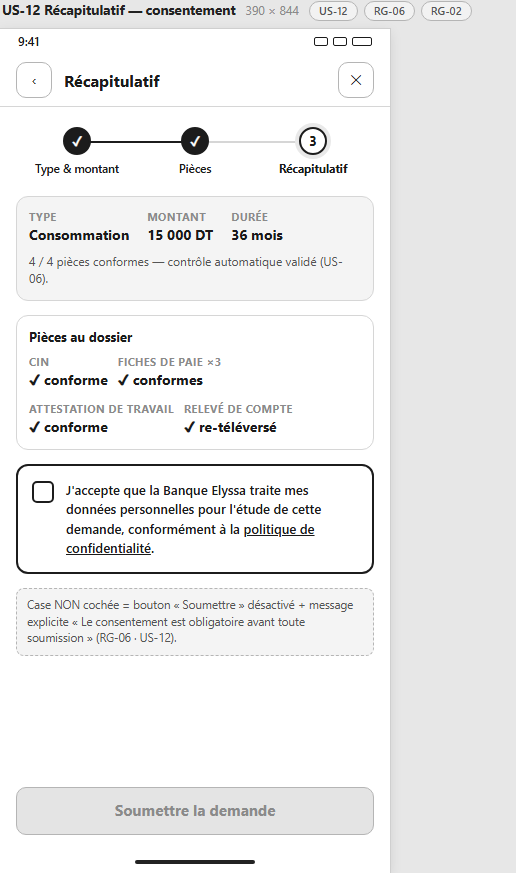

### Confirmation de dépôt — `US-01 · US-13 · RG-04`

Numéro de dossier unique, récépissé PDF téléchargeable, prochaines étapes expliquées, notification SMS +
e-mail automatique.

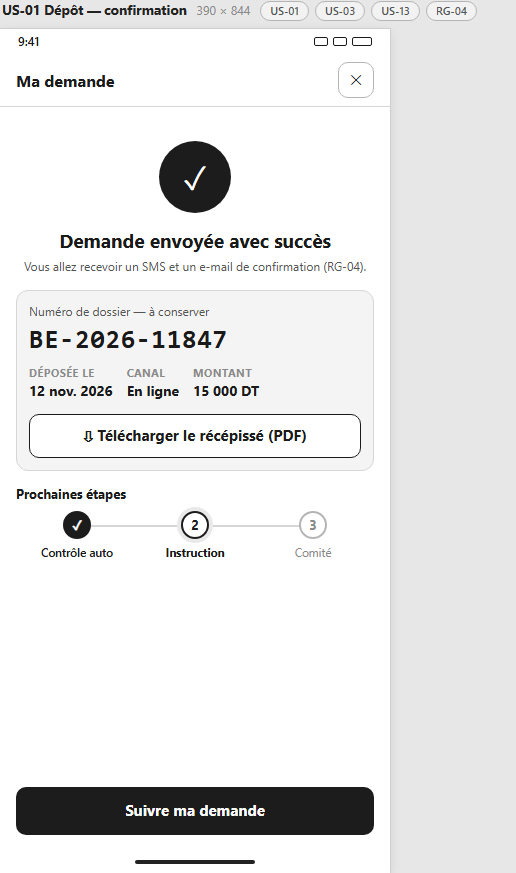

### Suivi de la demande — `US-02 · US-14 · RG-03 · RG-04`

Timeline verticale des états (déposé → en instruction → au comité → décidé) avec date prévue sur l'étape
courante, alerte « pièce manquante » avec bouton compléter, historique des notifications et rappel J+7.

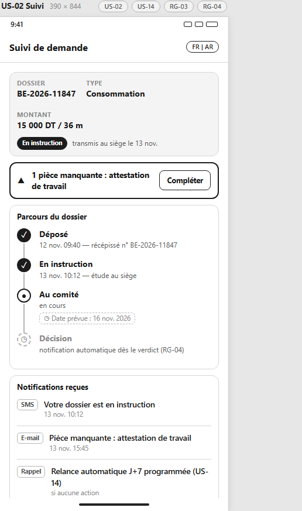

### Suivi — état vide — `US-02 · RG-01 · RG-02`

« Aucune demande en cours » + reprise du brouillon ; un dossier créé au guichet apparaît ici avec le même
numéro et la même timeline.

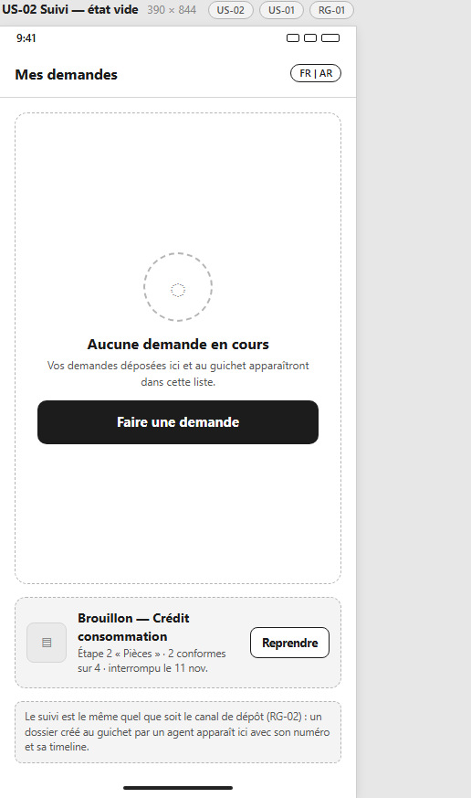

### Portail en arabe — miroir RTL — `US-03 · RG-07 · RG-04`

Même écran que le suivi, en arabe : navigation, alignements et icônes directionnelles inversés, **parité
fonctionnelle complète** avec le français.

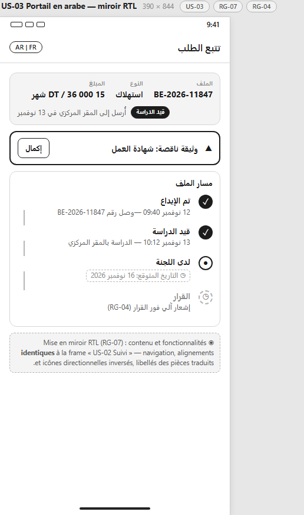

---

## 2. Agent d'accueil — desktop 1440 × 900

### Dépôt assisté au guichet — `US-04 · RG-02 · RG-04`

Recherche du client existant (aucun doublon), **le même formulaire que le parcours client**, récépissé envoyé
par SMS même sans compte portail. La fiche papier et les triples saisies disparaissent.

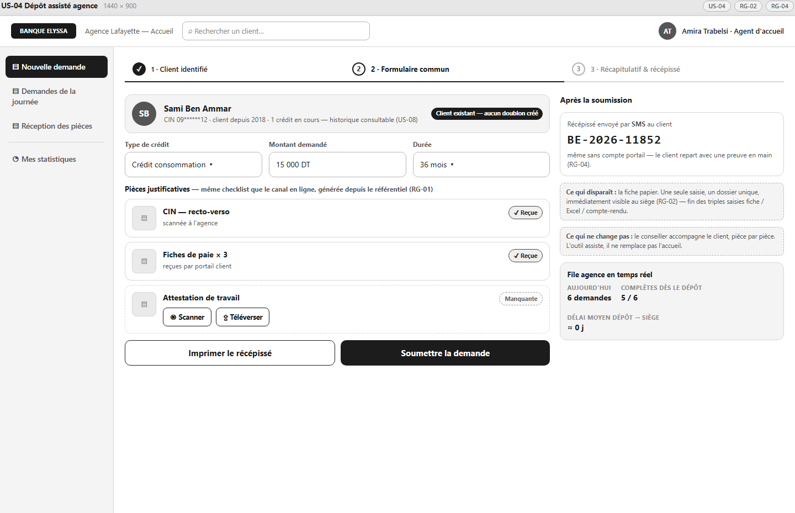

---

## 3. Siège — analyste, risques, comité — desktop 1440 × 900

### Tableau de bord analyste — `US-07 · US-08 · US-10 · US-11 · RG-03 · RG-04 · RG-05`

File de travail triable, dossier + pièces + avis d'instruction + journal dans un seul écran, transitions
limitées à celles autorisées par l'état courant, indicateurs calculés en continu.

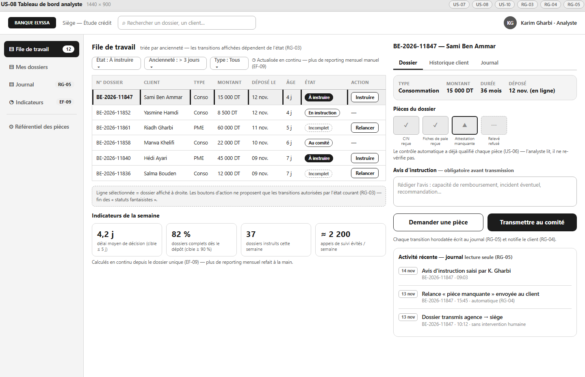

### Référentiel des pièces (responsable des risques) — `US-05 · US-06 · RG-01 · RG-05`

La liste des pièces par type de crédit se gère ici et se propage immédiatement au mobile et au guichet ;
les dossiers déjà déposés reçoivent un avertissement sans blocage rétroactif.

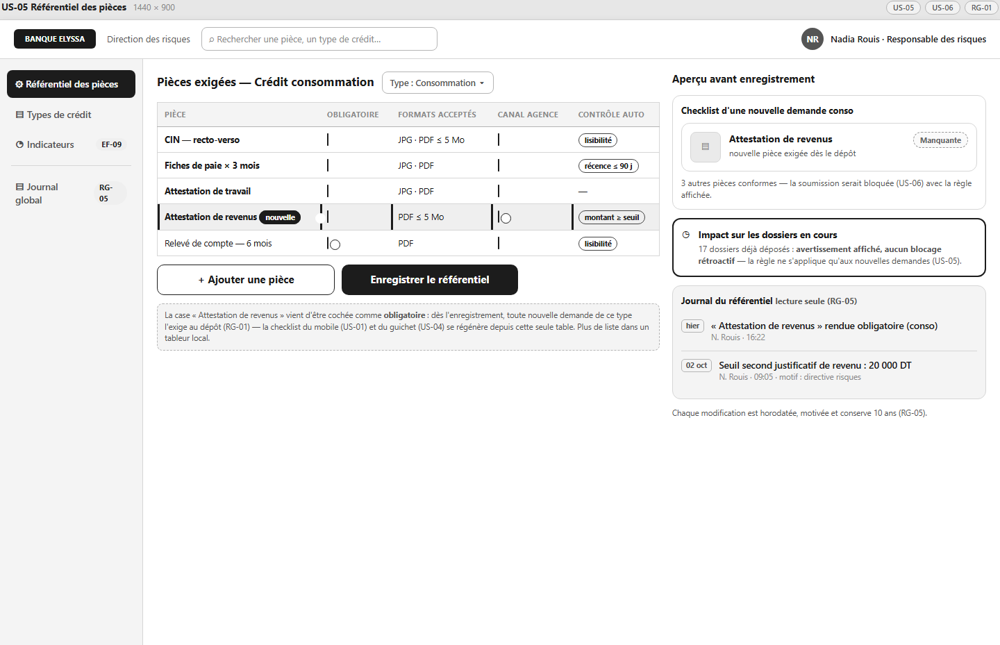

### Comité de crédit — décision — `US-09 · US-07 · US-10 · RG-03 · RG-04 · RG-05`

Le comité reçoit le dossier complet avec l'avis de l'analyste et l'historique client ; la décision reste
saisie manuellement, commentée et tracée, et notifie le client dès le verdict.

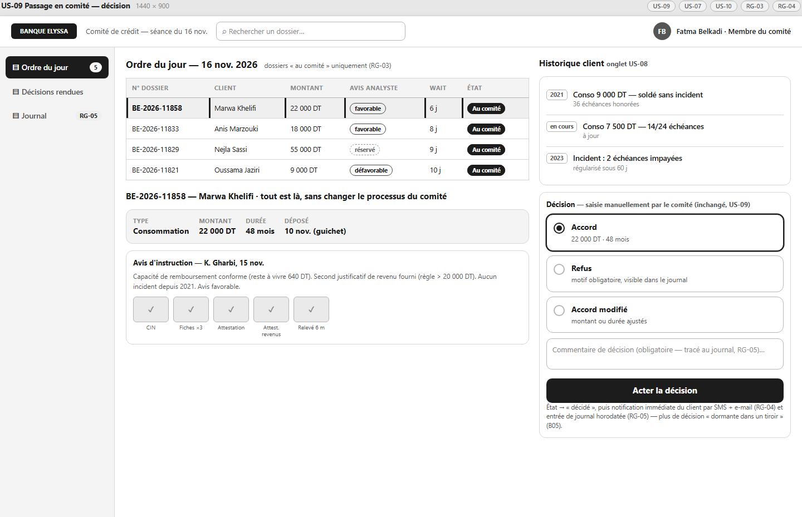

---

## Traçabilité — chaque frame référence ses exigences

| Frame | Écran | User stories | Règles de gestion |
|---|---|---|---|
| 01 | Dépôt — étape 1 type & montant | US-01, US-03 | RG-01 |
| 02 | Dépôt — étape 2 pièces | US-01, US-03 | RG-01 |
| 03 | Dépôt — soumission bloquée | US-06 | RG-01 |
| 04 | Récapitulatif — consentement | US-12, US-01 | RG-06, RG-02 |
| 05 | Confirmation de dépôt | US-01, US-13 | RG-04 |
| 06 | Suivi — timeline | US-02, US-14 | RG-03, RG-04 |
| 07 | Suivi — état vide | US-02 | RG-01, RG-02 |
| 08 | Portail arabe (RTL) | US-03 | RG-07, RG-04 |
| 09 | Tableau de bord analyste | US-07, US-08, US-10, US-11 | RG-03, RG-04, RG-05 |
| 10 | Dépôt assisté agence | US-04 | RG-02, RG-04 |
| 11 | Référentiel des pièces | US-05, US-06 | RG-01, RG-05 |
| 12 | Comité — décision | US-09, US-07, US-10 | RG-03, RG-04, RG-05 |

**Couverture :** les 14 user stories du backlog sont tracées par les 12 frames — les stories transverses
(US-11 indicateurs, US-13 récépissé PDF, US-14 rappel J+7) sont intégrées aux écrans 09, 05 et 06.

---

*Modèle de processus associé : [TO-BE](../to-be-processus.md) · Retour au [README du projet](../../README.md)*
